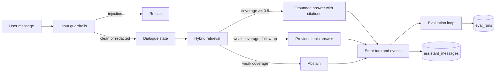

# Conversational AI Lab

A reference build of a production-minded conversational AI assistant. It covers the parts that make an assistant trustworthy after launch: grounded answers, conversation state across turns, guardrails on every message, saved conversations, and an automated evaluation loop with a score history.

> The live demo is a deterministic engine over a fixed knowledge base, so every reply can be traced to a source. The production design in this README swaps in an open-weight language model for generation and keeps the same guardrail and evaluation stages.

---

## Contents

<details open>
<summary><strong>1. What this project demonstrates</strong></summary>

| Requirement | Where it lives | How to see it |
| --- | --- | --- |
| Complex multi-turn conversational systems | `src/lib/assistant/engine.ts`, `src/hooks/useAssistantChat.ts` | Ask a question, then "how is that tested?" |
| RAG and context management | `src/lib/assistant/retrieval.ts`, `src/lib/assistant/knowledgeBase.ts` | Each reply lists the passages it cites |
| Dialogue state handling | `src/lib/assistant/engine.ts` (`activeSourceId`) | Follow-ups resolve to the previous topic |
| Ranking and retrieval | `src/lib/assistant/retrieval.ts` (BM25 with coverage scoring) | Abstention appears on unsupported questions |
| Evaluation loops | `src/lib/assistant/evals.ts`, `src/components/demo/EvalDashboard.tsx` | Click "Run suite" and watch the history grow |
| Guardrails | `src/lib/assistant/guardrails.ts` | Try an injection attempt or an email address |
| Monitoring | `eval_runs` and `assistant_messages` tables | Latency, intent, sources, and guardrail events are stored per reply |
| Persistence | `src/lib/assistantRepository.ts`, Supabase | Reload the page and the conversation is still there |
| Open-weight training and serving | Documented design (see below) | Architecture section of the landing page |
| Technical leadership | Engineering decisions in the landing page and below | Trade-offs written down with each decision |

</details>

<details>
<summary><strong>2. Architecture</strong></summary>



Each stage is a plain function with a single job:

- **Input guardrails** refuse prompt-injection attempts and redact personal data before retrieval.
- **Dialogue state** reads the cited source from the previous assistant turn so short follow-ups resolve correctly.
- **Retrieval** ranks passages with BM25 and reports how many query terms each passage covers.
- **Grounded answer** returns the matched passage and its citations, never free text without a source.
- **Storage** saves both turns with intent, sources, guardrail events, and latency.
- **Evaluation** runs a fixed golden set and stores each score for trend review.

</details>

<details>
<summary><strong>3. Design decisions</strong></summary>

**Abstain instead of guessing.** When query coverage falls below half, the assistant says it does not know. A confident wrong answer does more damage to trust than an honest gap.

**Redact before storage.** Personal data is removed before a message is answered or written to the database. Logs never hold raw email addresses, phone numbers, or card-like numbers.

**Evaluate on a fixed set.** The same eleven cases run every time, so a score change points to a code change rather than a different test.

**Deterministic engine for the demo.** A model call would make the demo unpredictable and hard to audit. The pipeline boundaries stay identical, so a model can be dropped into the generation stage later without touching guardrails, storage, or evaluation.

**Crude prefix stemming.** Terms are compared on their first six characters, so "evaluation", "evaluate", and "evaluated" match. This is simple and predictable, and it is easy to replace with a real stemmer or an embedding model.

</details>

<details>
<summary><strong>4. Production reference stack</strong></summary>

| Concern | Tool | Why |
| --- | --- | --- |
| Models | PyTorch | Training and fine-tuning |
| Fine-tuning | LoRA on open-weight models | Adapts a base model with a small number of trainable parameters |
| Orchestration | LangGraph | Explicit, testable multi-turn state machines |
| Typed outputs | Pydantic AI | Validated structured replies and tool calls |
| Vector search | Qdrant | Dense retrieval with payload filters |
| Reranking | Cross-encoder | Reorders the top retrieved passages by relevance |
| Inference | vLLM | Batched, high-throughput serving of open-weight models |
| Evaluation | DeepEval | Automated LLM test suites for regression checks |
| Frontend | React, Vite, Tailwind CSS | This demo |
| Data | Supabase (Postgres) | Saved conversations and evaluation history |

</details>

<details>
<summary><strong>5. Run it locally</strong></summary>

Requirements: Node.js 20.19 or newer.

```bash
npm install
npm run dev
```

The app reads two environment variables, `VITE_SUPABASE_URL` and `VITE_SUPABASE_ANON_KEY`. If they are missing, the chat and evaluation panels show a visible error instead of failing silently.

Production build and type check:

```bash
npm run build
npm run typecheck
```

</details>

<details>
<summary><strong>6. Data model</strong></summary>

**`assistant_messages`** stores one row per chat turn.

| Column | Purpose |
| --- | --- |
| `session_id` | Groups the turns of one browser conversation |
| `role` | `user` or `assistant` |
| `content` | Message text, capped at 2,000 characters, personal data already redacted |
| `intent` | Topic of the cited passage |
| `sources` | Cited passages (id and title) |
| `guardrails` | Safety events that fired for the reply |
| `latency_ms` | Time spent producing the reply |

**`eval_runs`** stores one row per evaluation run: `score`, `passed`, `total`, and per-case `details`.

Both tables use row level security. The demo has no sign-in, so the public anonymous key can read and write them. Content length is limited in the database to reduce abuse.

</details>

<details>
<summary><strong>7. Project structure</strong></summary>

```
src/
  App.tsx                         Page composition
  index.css                       Base styles
  lib/
    supabase.ts                   Database client
    assistantRepository.ts        Saves and loads turns and eval runs
    assistant/
      types.ts                    Shared types
      knowledgeBase.ts            Passages the assistant can cite
      text.ts                     Tokenizing and term matching
      retrieval.ts                BM25 ranking with coverage
      guardrails.ts               Injection detection and PII redaction
      engine.ts                   The reply pipeline
      evals.ts                    Golden set and evaluation runner
  hooks/
    useAssistantChat.ts           Chat state, persistence, errors
  components/
    landing/                      Navigation, hero, capabilities, architecture, footer
    demo/                         Chat, message bubbles, evaluation dashboard
```

</details>

<details>
<summary><strong>8. Roadmap to full production</strong></summary>

1. Replace the deterministic generator with a served open-weight model behind the same `respond` interface.
2. Move retrieval to Qdrant with dense embeddings and a cross-encoder reranker.
3. Run the evaluation suite in CI and fail builds when the score drops below an agreed threshold.
4. Add per-user accounts and row-level ownership before storing any real user data.
5. Send guardrail and latency events to a monitoring dashboard with alerts.

</details>

---
